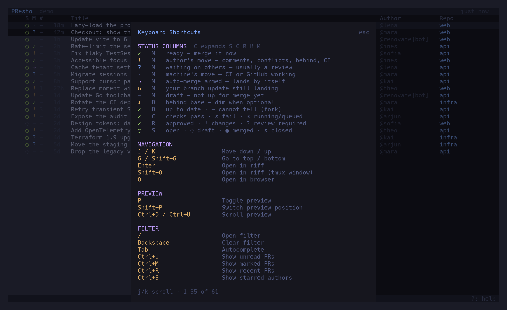
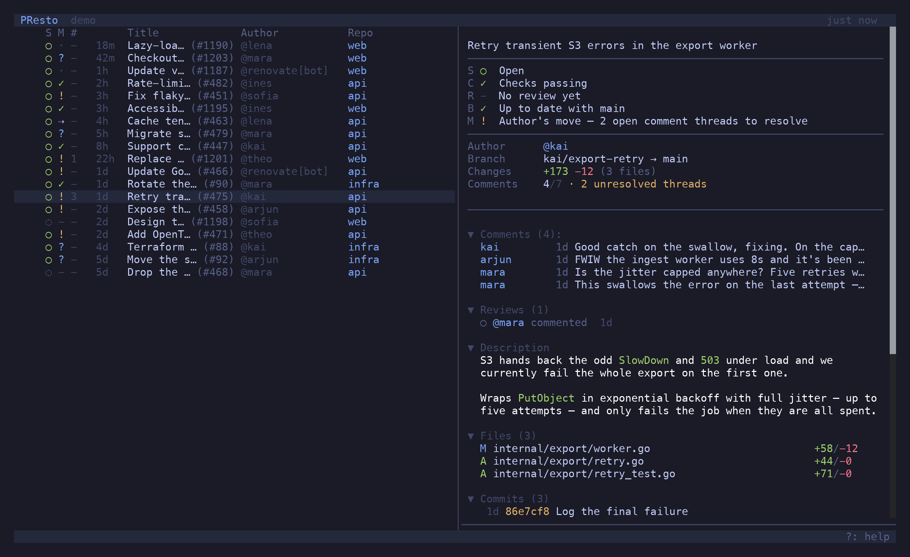

Every row carries five status columns. The first four are single-glyph **gates** GitHub
evaluates; the fifth is presto's **verdict** on them: whose move it is. Where that glyph
alone is ambiguous, the end of the title says in a word what is holding the PR up. `c`
toggles between the verdict alone and all five; `?` shows this legend in the app.



## S — State

| Glyph | Meaning |
| --- | --- |
| `○` green | open |
| `◌` dim | draft |
| `●` purple | merged |
| `✗` red | closed |

## C — Checks

| Glyph | Meaning |
| --- | --- |
| `✓` | every check passed (skipped, cancelled and neutral ones are ignored) |
| `✗` | a check failed, timed out, or failed to start |
| `*` | a check is running — or queued but not yet started |
| `-` | no checks on this commit |

GitHub's rollup only counts runs that have *started*, so a commit whose suites are all still
queued would otherwise look like a repo with no CI. presto reads the suites too and shows `*`
for "queued, nothing started yet".

## R — Review

| Glyph | Meaning |
| --- | --- |
| `✓` green | approved — GitHub's review decision |
| `✓` dim | approvals stand, but GitHub reports no decision (happens; the tick is the receipt) |
| `!` | changes requested |
| `?` | review required |
| `-` | no review yet |

Bots are not reviewers: an approval or a thread from `renovate[bot]`, Copilot or anything
matching `bot_patterns` does not count.

## B — Base

Where the head branch sits relative to its base — independent of the merge state, which folds
"behind" into "blocked" whenever both apply.

| Glyph | Meaning |
| --- | --- |
| `✓` | up to date with the base branch |
| `↓` yellow | behind, and the base branch **requires** PRs to be up to date — this blocks the merge |
| `↓` dim | behind, but updating is optional |
| `-` | cannot tell: a fork PR, or the REST fallback path |

Whether the base requires an update comes from the repo's rulesets (`rules/branches`), which
need only read access — classic branch protection needs admin rights and 404s for most people.

## M — Merge verdict

The single answer to *who is holding this up?*. The reason sits at the right edge of the
title, in a word, where it tells you something the glyph does not. Only rows with a reason
give up title width for it, and on a list too narrow for both the reason goes before the
title does. The preview spells every reason out.

The glyph is the verdict, the same for everyone. The reason's colour is what the PR needs
from **you**, the logged-in `gh` user:

| Colour | Means | Words |
| --- | --- | --- |
| green | nothing more needed from you | `ready` — your PR can be merged · `approved` — you approved it and it waits only on others · `#1 ~3m` once mergeable in the queue |
| amber | the author has to act | `conflicts`, `behind`, `changes`, `2 failing`, `3 threads`, `stalled`, `queue err` |
| blue | a review is open and could be yours | `review` — someone else's PR you have not approved |
| muted | nobody's to give, or not yours | `CI 5/8`, `CI queued`, `computing`, `blocked`, `updating`, `#1 ~3m` while it waits |

Your own PR waiting for review, someone else's ready PR you did not approve, auto-merge and
drafts carry no word: there is nothing in them for you. The author's move outranks your
approval — a PR you approved that grew a conflict turns amber.

Deliberately not blocked / pending / ready:
measured across the configured repos, that split put 86 % of open PRs in "blocked" and made the
column a constant. Sorting by whose move it is spreads the same PRs across buckets that each
imply a different next step.

| Glyph | Verdict | When |
| --- | --- | --- |
| `✓` green | **ready** | merge state is clean or has hooks; or unstable (only a non-required check is red — GitHub offers the merge, the checks column carries the warning) |
| `⧗` blue | **queued** | the PR is in the merge queue: its place in line and GitHub's estimate. Green once GitHub calls it mergeable in the queue; unmergeable there is the author's move |
| `⇢` purple | **auto-merge** | auto-merge is armed; it lands by itself when the gates clear |
| `!` yellow | **author's move** | anything only the author can clear, in this order: open comment threads · conflicts · behind a base that requires it · changes requested · failing checks · required checks that never started |
| `?` blue | **waiting on others** | a review is required; or reviewed, green and still blocked (`blocked`) — a rule presto cannot see gates it: a required deployment, a CODEOWNER, a required check that never reported |
| `·` dim | **machine's move** | checks are running, queued, or GitHub is still computing the merge state |
| `↻` yellow | **pending** | you fired a branch update and GitHub has not landed it yet; clears when a refresh shows a new head commit, or after two minutes |
| `-` dim | **draft** | not up for merge, so no verdict — nothing GitHub reports about a draft is trustworthy enough to build one on |

Two rules worth knowing:

- **Open threads outrank everything.** Many teams block by *commenting* rather than by
  requesting changes, so GitHub reports "review required" (or even "clean") on a PR whose
  reviewer is in fact waiting on the author. An unresolved thread is the author's move, and
  only once every thread is resolved does an unapproved PR go back to waiting for a review.
- **A review outranks running CI.** The review is the bottleneck a human can clear now; CI
  finishes on its own either way.

## In the preview

The preview opens with a **Merge status** section: the verdict written out — *Author's move —
2 open comment threads to resolve*, derived from the same PR object the row renders, so the
two can never disagree — then one line per gate GitHub applies, so nothing hides behind the
first thing that blocks:

```
Merge status  ⧗ Queued #1 · awaiting checks · ~3m

✓ Checks         8/8 passed
✓ Reviews        1 approval by luethis
✓ Conversations  all resolved
○ Conflicts      checking
⚠ Base           1 commit behind master
⧗ Queue          #1 · awaiting checks · ~3m · added by candril 2m ago
○ Blockers       GitHub is still computing the merge state
```

`✓` fine, `⚠` a warning, `✗` blocks, `○` pending, `ℹ` information. Failing and running checks
are listed under the Checks line by name; when every check is green there is no list. Behind
counts come from comparing the branch with its base when the preview loads. Branch protection
is named only when none of the gates above explains why GitHub blocks the merge.



## The comment column

`#` counts comments that are still **open**: those inside unresolved review threads. A PR with
twelve comments of which ten are settled reads as `2`; conversation comments and review bodies
cannot be resolved and are not counted. The preview shows `settled/total`.
